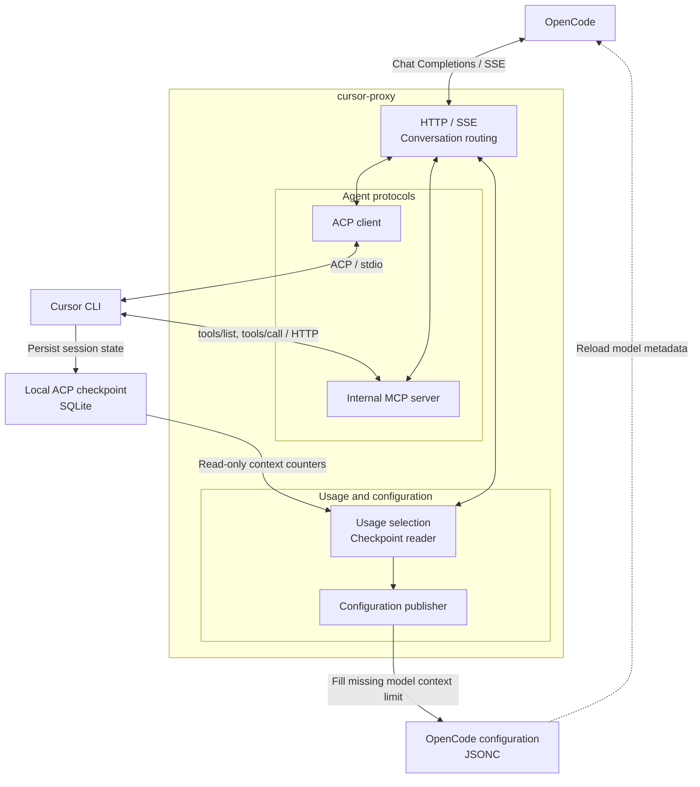

# Cursor Proxy design

## Scope

Cursor Proxy connects a local OpenCode client to the installed Cursor CLI. OpenCode uses OpenAI-compatible HTTP; the proxy drives Cursor through ACP and exposes OpenCode tools through an internal MCP server. Cursor retains ownership of its authentication and native agent runtime.

This document describes the implementation. Installation and startup instructions are in [README.md](README.md) and [README_zh.md](README_zh.md).

## Command line

`cursor-proxy [OPTIONS]` starts the foreground service directly. `-h` and `--help` show the same options and their purpose; there are no subcommands.

`--password` sets the proxy access password, independently of Cursor account login. It is optional for loopback listeners and required for non-loopback listeners. The HTTP API continues to use `Authorization: Bearer <password>`. Automatic OpenCode configuration stores the password in the provider's `options.apiKey` for V1 or `settings.apiKey` for V2. `/health` remains public. This naming change does not change the wire protocol or add transport encryption.

## Components

| Module | Responsibility |
| --- | --- |
| [server.rs](src/server.rs) | HTTP validation, workspace resolution, request dispatch |
| [session.rs](src/session.rs) | Conversation ownership, host-result correlation, output ordering, recovery |
| [acp.rs](src/acp.rs) | Official Rust ACP client, ordered RPC responses, notifications, permission handling |
| [mcp.rs](src/mcp.rs) | Authenticated loopback tool server, schema validation, pending host results |
| [agent.rs](src/agent.rs) | Cursor launcher and subprocess lifetime |
| [chat/sse.rs](src/chat/sse.rs) | JSON and OpenAI-compatible SSE responses |
| [usage.rs](src/usage.rs), [stream/events.rs](src/stream/events.rs) | Usage priority, bounded checkpoint reads, context fallback, OpenAI counter mapping |
| [models.rs](src/models.rs), [config.rs](src/config.rs) | Model discovery and automatic OpenCode configuration |

The ACP lifecycle follows patterns from Zed's [connection implementation](https://github.com/zed-industries/zed/blob/b6ff193ba604dba841c78cbdee7357f9c420ef9d/crates/agent_servers/src/acp/v1.rs), [runtime](https://github.com/zed-industries/zed/blob/b6ff193ba604dba841c78cbdee7357f9c420ef9d/crates/agent_servers/src/acp/runtime.rs), and [transport](https://github.com/zed-industries/zed/blob/b6ff193ba604dba841c78cbdee7357f9c420ef9d/crates/agent_servers/src/acp/transport.rs). It does not depend on Zed's UI framework.

## Conversation lifetime

Each new conversation owns an ACP connection, its child process, and any internal MCP bridge. The store tracks two states:

| State | Meaning | Next transition |
| --- | --- | --- |
| Running | Cursor is generating a reply | Host tool handoff, completion, cancellation, or error |
| Tools | OpenCode owns the next tool execution step | Matching results reattach to Running |

The store admits at most 64 active conversations. Identical concurrent initial prompts create independent conversations. Final completion closes the ACP connection and MCP bridge, terminates the owned child process, and removes the store entry. Completed conversations are not retained in an idle cache.

Tool continuation belongs to the currently running ACP prompt and needs no extra option. A subsequent user turn starts a new ACP conversation with the history supplied by OpenCode. The proxy does not load completed sessions or restore them after restart.

## Host tool round trip

1. The request's effective tool catalog becomes MCP definitions, with names, descriptions, and JSON Schemas.
2. Cursor calls the internal MCP server; the proxy validates the exact tool name and arguments.
3. The proxy assigns a host call ID and returns OpenAI `tool_calls` to OpenCode.
4. The HTTP response completes, but the ACP prompt and original MCP call remain pending.
5. OpenCode executes the tool and submits a new request containing the matching result.
6. The proxy validates pending IDs, history, and the conversation fingerprint before completing the original MCP call.
7. Cursor continues generating into the new HTTP reply.

Unknown, duplicate, expired, or mismatched results are rejected. Parallel MCP calls are handed to the host through successive reply attachments. ACP native-tool status notifications do not independently create OpenCode tool executions.

The MCP bridge uses a random per-bridge bearer credential and binds to `127.0.0.1`. It rejects browser Origin headers, validates request sizes, and admits at most 16 pending calls. Explicit MCP cancellation releases the pending result receiver.

## Plan policy and mode selection

The proxy recognizes OpenCode's exact user-role Plan/Build reminders. The latest recognized reminder selects the mode; ordinary prose, quoted reminders, assistant messages, and tool output do not. Unrecognized or absent reminders default to Build.

Original tool definitions are validated before constructing the effective catalog. Build retains declared tools subject to `tool_choice`. Plan admits only the exact builtin names `read`, `glob`, `grep`, and `question` when present in the request. Descriptions, aliases, and `readOnlyHint` metadata do not authorize a tool. This policy assumes trusted OpenCode builtin implementations; a name alone cannot authenticate a replacement implementation.

| Tool choice | Admission behavior |
| --- | --- |
| `none` | Empty host-tool catalog, after validating original definitions |
| Named function | Select only that declared, mode-permitted tool; reject missing or forbidden names with HTTP 400 before starting Cursor |
| `required` in Plan | Reject with HTTP 400 if filtering leaves no permitted tool |
| `auto` or omitted | Use the effective catalog; an empty Plan catalog permits text-only replies |

The MCP server filters discovery and independently rejects forbidden direct calls before host handoff. ACP permission grants use the same policy and retain session/server correlation and single-use consumption. Replacing the grant policy clears pending grants. Plan therefore rejects bridge writes even to OpenCode's plan directory, command execution, delegation, and unsupported custom readers. Build keeps the existing tool behavior.

Before prompting, the proxy selects Cursor's `plan` or `agent` mode through `session/set_config_option` when a mode option exists, otherwise through advertised legacy `session/set_mode`. It validates flat or grouped selectable values and awaits successful selection. Missing requested values or rejected RPCs fail without prompting; a rejected advertised control is not bypassed through another control. Without either control, Plan fails while Build may proceed without explicit mode selection.

The conversation fingerprint retains the raw tools, tool choice, and execution mode, so filtering does not allow cross-mode tool-result continuation. These bridge controls and Cursor mode selection do not sandbox Cursor's native runtime or make OpenCode permissions universal.

## Event ordering and cancellation

ACP notifications and MCP calls arrive on different transports. Their relative order cannot be inferred from arrival order alone.

- ACP RPC callbacks wait for the caller to apply responses before dispatching later messages.
- Before host tool handoff, a mode-setting RPC establishes an ACP response boundary and preceding notifications are drained into the current reply.
- While waiting for host results, ACP input continues to be consumed. Unassignable text or reasoning fails the conversation rather than leaking into a later reply.
- Before returning host results, another ordered boundary checks queued content.
- Setup, output sends, and ordering RPCs respond to disconnect, shutdown, and deadlines.

The notification queue is bounded by both count and bytes. Process shutdown has a bounded drain even if the child stops reading stdin or descendants retain its output pipes. Unix process groups and the existing Windows tree-termination launcher support cleanup; detached processes are not a sandbox guarantee.

## Reasoning-only recovery

An ACP turn can return `end_turn` after emitting reasoning without reply text. The proxy treats this as a recoverable condition only when all of the following hold:

- The current reply text is empty and nonempty reasoning was observed.
- The prompt ended normally, without a protocol error or cancellation.
- No MCP call has been handed off, no host call is queued or awaiting a result, and tool-choice constraints are satisfied.
- No tool activity was observed since this user turn's prompt began.
- No recovery prompt has been sent for this user turn, and the client and original deadline remain active.

The ACP decoder counts native tool creation/update events, permission and other agent-to-client requests, and Cursor task/image notifications before application-level dispatch. This prevents already-queued activity from being missed by a later completion check. The count is compared with a baseline for the user turn; it is not cleared by a host-result attachment.

The MCP ingress separately counts authenticated `tools/call` requests, including rejected or cancelled requests. A missing ACP tool notification or an already-closed host-result receiver does not erase that activity. Both counters and queued calls are checked again after clearing permission grants and before submitting recovery.

Recovery sends one short final-answer request to the same ACP session. It does not replay history or the original task, select another model, or reset the request deadline. Both attempts remain part of one HTTP completion and share its completion ID. Reasoning stays in `reasoning_content` and is never substituted for reply text.

Host tool permission grants are cleared before recovery. New MCP calls or observed native tool activity during recovery fail the conversation. A second empty reply also fails. The recovery budget resets only for a new user turn, not for each internal prompt or tool attachment.

These checks use observed protocol activity. Cursor native operations can occur without a client permission request, and the proxy cannot undo them. Recovery is not a pre-execution sandbox or proof that no unreported side effect occurred. It may incur an additional model call; its success rate depends on the CLI and model.

## Usage and context estimates

The proxy supplies the existing OpenAI-compatible `usage` interface. It does not require OpenCode changes or an OpenCode plugin. [usage.rs](src/usage.rs) selects the first available source in this order:

| Priority | Source | Meaning |
| --- | --- | --- |
| 1 | Valid counters in ACP `result.usage` | Reported input, output, cache, and reasoning breakdowns; explicit zero values remain authoritative |
| 2 | Latest valid same-session `usage_update` observed during the current user turn | ACP `used` and `size` context snapshot |
| 3 | Exact ACP session's local checkpoint | Latest persisted `used_tokens` and `max_tokens`, subject to baseline freshness checks |

Reported counters from separate internal recovery attempts are summed once within the user turn. Missing recovery counters do not erase an earlier report. Each new user turn owns independent reported and context observations; host-result attachments retain those of their running ACP prompt. Context updates are consumed from live notifications and both handoff ordering drains. Optional cumulative ACP cost is not converted into per-response charges.

### Local checkpoint adapter

The Cursor configuration root resolves from nonempty `CURSOR_CONFIG_DIR`, then `XDG_CONFIG_HOME/cursor`, then the user home `.cursor` directory. Home resolution uses the platform's home environment variables, preferring `USERPROFILE` on Windows. The reader opens only `acp-sessions/<session-id>/store.db` for the canonical UUID returned by Cursor. It rejects paths that resolve outside that exact store and does not query authentication configuration or other-session history.

The adapter reads the observed local schema, not a public Cursor usage API:

1. Open SQLite read-only with `query_only` and one read transaction; require schema version 1.
2. Read metadata key `0`, decode its hex-encoded JSON, and obtain `latestRootBlobId`.
3. Validate the 64-hex identifier, read its blob, and verify its SHA-256 digest.
4. Decode protobuf root field 5, then context fields 1 and 2 for used tokens and capacity.

Metadata text is capped at 64 KiB and the root blob at 2 MiB. SQLite has a row/BLOB length limit; protobuf decoding bounds lengths and integers and rejects malformed or duplicate context fields. SQLite's busy timeout is 25 ms and asynchronous observation has a 50 ms budget. Missing, unreadable, locked, malformed, or incompatible state suppresses optional statistics rather than failing the chat.

A root baseline is captured before the first ACP prompt of each user turn. A valid new store with an empty root differs from a failed baseline read. If baseline observation fails, local fallback is withheld for that turn. If the root still equals that turn's baseline at the reply boundary, it is also withheld. A changed root with identical counters is accepted. A changed root proves newer persistence, not that every counter reflects the latest generation; context fallback can lag.

SQLite is bundled into the proxy executable; no SQLite CLI is invoked. Read-only database access can use SQLite's normal WAL/SHM bookkeeping. The adapter does not treat live WAL databases as immutable. Timeouts bound awaiting observation, not physical cancellation of a filesystem operation already running in a blocking worker.

### Standard response mapping

| Source | `prompt_tokens` | `completion_tokens` | `total_tokens` |
| --- | --- | --- | --- |
| Reported breakdown | Input + cache-read + cache-write | Reported output | Prompt + completion |
| Context fallback | `used_tokens`, or ACP `used` | 0 | Same used-context count |

Reported cache and reasoning subsets populate `prompt_tokens_details` and `completion_tokens_details`. For context fallback, zero output/cache/reasoning buckets are compatibility placeholders, not measured breakdowns. `usage.cursor_proxy.source` is `context_snapshot`, and `usage.cursor_proxy.context_window` carries observed capacity. Context occupancy is not represented as a verified billable-token total.

When statistics are available, JSON includes one `usage` object. SSE sends a normal finish chunk, one usage chunk with `choices: []`, then `[DONE]`. Each HTTP attachment resolves its own statistics. Unavailable statistics omit `usage`; an explicit reported zero is still emitted.

### Window publication and cost

The completion observer publishes observed capacity before forwarding `Done` when automatic configuration is enabled. It fills a missing `limit.context` on an existing matching `cursor-proxy` model; V1's native unknown context value of zero is also fillable, as described below. Known limits, prices, comments, and unrelated configuration remain unchanged. Configuration reload in OpenCode is asynchronous; publishing the file does not imply instant visibility in its model catalog.

Capacity publication and catalog synchronization share a process-local mutex and the same backup/atomic replacement path. External file changes are checked before replacement. Publication has a 100 ms observation budget and cancellation checks after acquiring the mutex and before rename. A cancellation guard prevents queued publication from becoming a late configuration update. Publication errors do not fail the chat or extend its original timeout.

OpenCode uses its normalized token buckets and configured window to calculate the displayed context count and percentage. Under fallback, the count is the observed used context, and percentage depends on the effective `limit.context`, which may be an explicit user override.

The proxy neither invents model prices nor forces `usage.cost` to zero. OpenCode can estimate cost from configured rates and the compatibility counters; without rates, a dollar value may not appear. Context snapshots can repeat across host steps, so their accumulated estimates are not per-call billing measurements or Cursor invoices. Reported counters, billing charges, and context occupancy remain distinct sources of information.

## Errors and output

Text and reasoning chunks retain receive order. JSON requests aggregate them; streaming requests emit SSE deltas followed by one completion boundary. Optional statistics follow the source priority and estimate labeling described above.

An error before the first output can become an HTTP error. After an SSE response starts, errors are returned inside the stream. Cancelled or timed-out work is not automatically replayed. Unsupported blocking Cursor interactions are explicitly skipped or rejected rather than approved silently.

## Model and workspace context

The model catalog is discovered through the CLI on startup and every hour. HTTP model requests only read the cache. Configuration publication precedes cache replacement; refresh failures retain the previous catalog and configuration.

### OpenCode version and configuration format

At startup the proxy invokes the OpenCode CLI found through `PATH` with `--version`. Detection selects by major version, not a particular release: all parsed `1.x` versions use V1, and `2.x` uses V2, including prerelease/build suffixes. The probe has a two-second deadline and an 8 KiB limit on each output stream. Missing, failed, oversized, unrecognized or unsupported version output produces a warning and retains the V2 default. No version flag is exposed. Windows uses native executables or PowerShell launchers; npm `.cmd` launchers require their sibling `.ps1` file, without shell command interpolation.

One immutable format selection is shared by model-catalog and context-capacity publication for the proxy lifetime. Switching the OpenCode installation requires restarting the proxy. The installation found on `PATH` must be the one the user intends to configure; this does not detect an unrelated GUI installation automatically.

| Setting | V1 | V2 |
| --- | --- | --- |
| Provider map | `provider` | `providers` |
| Runtime package | `npm: @ai-sdk/openai-compatible` | `package: @opencode/ai/providers/openai-compatible` |
| Endpoint and access password | `options.baseURL`, `options.apiKey` | `settings.baseURL`, `settings.apiKey` |
| Tool/text capabilities | `tool_call`, `modalities` | `capabilities` |
| Reasoning field | Model `reasoning` and `interleaved.field` | Provider `compatibility.reasoningField` |

Both formats list discovered models explicitly, so OpenCode can select them without `/connect` or manual model entries. `1.18.16` is a runtime verification sample, not the version-selection criterion. Registering models does not prove every historical V1 release has identical reasoning, tool or Plan-reminder behavior.

Publication preserves the target format's overrides. Known names, aliases, limits, prices and capabilities from a matching model in the other format are translated as defaults beneath target overrides. Unknown fields and the inactive source entry stay untouched. Passwords and model headers are inherited only when the source endpoint is known and matches the selected endpoint; credentials from absent or different endpoints are not copied. Incomplete pricing that cannot satisfy V1's required input/output pair fails publication before replacement, rather than inventing a rate.

V1 requires both `limit.context` and `limit.output` when a limit object is present. When filling a missing field, zero preserves V1's native unset-limit fallback; it is not an observed output capacity. An observed context capacity can replace a missing V1 context or integer zero, including user-written zero, because both mean unknown context. Positive explicit context values and explicit output limits remain unchanged. V2 continues to fill only missing context limits, preserving explicit zero as before. The V1 schema and fallback are documented in the official [V1 provider schema](https://github.com/anomalyco/opencode/blob/v1.18.16/packages/core/src/v1/config/provider.ts) and [provider loader](https://github.com/anomalyco/opencode/blob/v1.18.16/packages/opencode/src/provider/provider.ts).

The startup workspace is always declared trusted to Cursor, using the canonical `--workspace` directory or the current directory when omitted. Trust does not extend to a different directory selected by a request header. Optional `--load-skills` injects the selected workspace root's `AGENTS.md` into prompts. Mode selection and host-tool policy are described above. These controls do not override Cursor's own native tools or account policies.

## Verification seams

- [ACP tests](tests/acp.rs) exercise notification staging, response application, Plan-filtered grants, cancellation, and child ownership.
- [MCP tests](tests/mcp.rs) exercise discovery/direct-call policy, access controls, and original-call result delivery/cancellation.
- [Conversation tests](tests/session.rs) exercise thread and mode isolation, history matching, completed-process cleanup, per-turn usage isolation, backpressure, and bounded recovery.
- [HTTP tests](tests/http.rs) exercise JSON/SSE mapping, reported-usage priority including zero and recovery, effective catalogs, workspace behavior, and automatic configuration.
- [Checkpoint tests](tests/usage.rs) exercise read-only state, schema/decoder limits, WAL, lock contention, root freshness, missing/corrupt stores, publication cancellation, and executable JSON/SSE fallback.
- [Configuration tests](tests/config.rs) exercise missing-limit publication, preserved overrides/prices, JSONC, and concurrent catalog/context writes.
- [OpenCode compatibility tests](tests/opencode.rs) exercise major-version parsing, bounded CLI probing, and automatic V1/V2 catalog/capacity paths through JSON and SSE with isolated executables.

Mock protocol tests establish deterministic behavior, not a measured real-model recovery rate. Real CLI validation must distinguish successfully recovered content from upstream reasoning-only output and must not hide unsuccessful attempts with unbounded retries.
