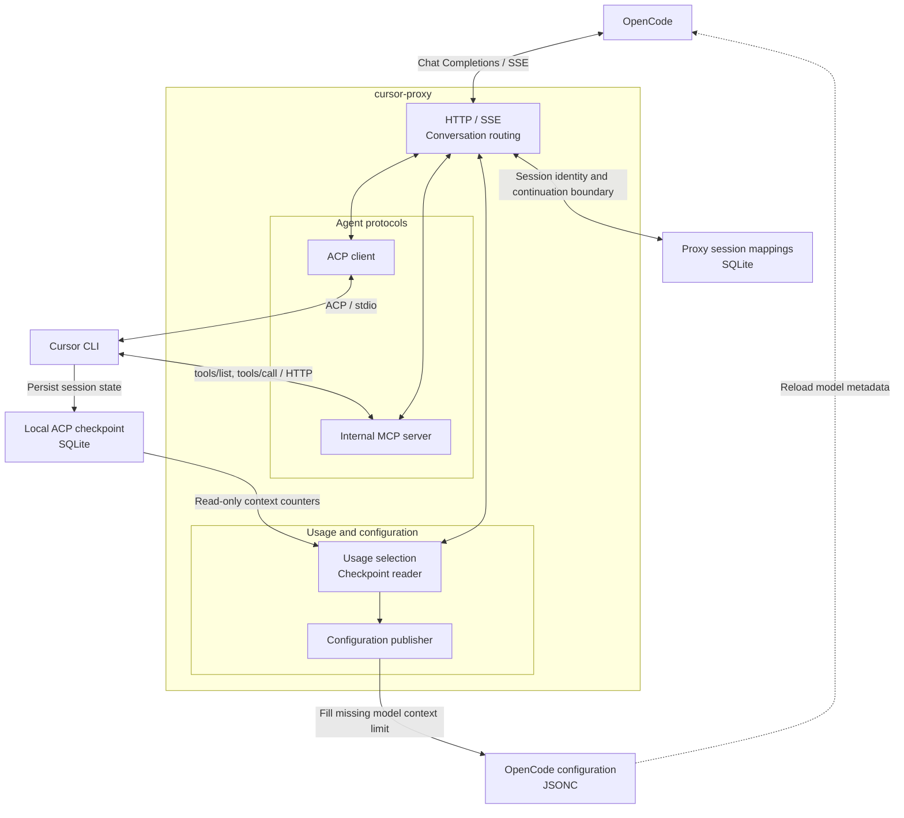

# Cursor Proxy design

## Scope

Cursor Proxy connects a local OpenCode client to the installed Cursor CLI. OpenCode uses OpenAI-compatible HTTP; the proxy drives Cursor through ACP and exposes OpenCode tools through an internal MCP server. Cursor retains ownership of its authentication and native agent runtime.

## Command line

`cursor-proxy [OPTIONS]` starts the foreground service directly. `-h` and `--help` show the same options and their purpose; there are no subcommands.

`--password` sets the proxy access password, independently of Cursor account login. It is optional for loopback listeners and required for non-loopback listeners. The HTTP API uses `Authorization: Bearer <password>`. Automatic OpenCode configuration stores the password in the provider's `options.apiKey` for V1 or `settings.apiKey` for V2. `/health` remains public. The listener serves plain HTTP.

## Components

| Module | Responsibility |
| --- | --- |
| [server.rs](src/server.rs) | HTTP validation, workspace resolution, request dispatch |
| [session.rs](src/session.rs) | Conversation ownership, host-result correlation, output ordering, recovery |
| [session/database.rs](src/session/database.rs) | Persistent session mappings, timestamps, 90-day expiry |
| [session/runtime.rs](src/session/runtime.rs) | Live Cursor runtime, official session loading, mode and MCP refresh |
| [acp.rs](src/acp.rs) | Official Rust ACP client, ordered RPC responses, notifications, permission handling |
| [mcp.rs](src/mcp.rs) | Authenticated loopback tool server, catalog publication, pending host results |
| [agent.rs](src/agent.rs) | Cursor launcher and subprocess lifetime |
| [chat/sse.rs](src/chat/sse.rs) | JSON and OpenAI-compatible SSE responses |
| [usage.rs](src/usage.rs), [stream/events.rs](src/stream/events.rs) | Usage priority, bounded checkpoint reads, context fallback, OpenAI counter mapping |
| [models.rs](src/models.rs), [config.rs](src/config.rs) | Model discovery and automatic OpenCode configuration |

## Conversation lifetime

Each live conversation owns an ACP connection, its child process, and any internal MCP bridge. The store tracks three states:

| State | Meaning | Next transition |
| --- | --- | --- |
| Running | Cursor is generating a reply | Host tool handoff, Idle, cancellation, or error |
| Tools | OpenCode owns the next tool execution step | Matching results reattach to Running |
| Idle | A completed turn retains its process and session | Next user turn returns to Running |

The store keeps at most 64 live conversations. At capacity, it releases the least recently used idle runtime without deleting its mapping; if every runtime is busy, admission returns HTTP 429. Idle time does not consume a reply timeout. Shutdown closes owned processes and bridges while retaining durable mappings.

After persisting a completed boundary and delivering `Done`, the actor releases the completed request's messages, raw tools and tool choice, reply allocation and request log span. The initial rendered prompt is dropped after submission. Running requests and pending tool handoffs retain their context; the live runtime and effective MCP publication remain available between turns.

OpenCode identity comes from `x-opencode-session-id`, falling back to legacy `X-Session-Id`. Affinity and parent-session headers are not identities. Mappings are scoped by that identity, canonical workspace and selected model. Exact conversation-history prefixes distinguish independent histories under the same identity, including auxiliary title generation and rewritten/forked histories. Concurrent initial requests use independent runtimes. Requests without an identity use an independent, non-persistent runtime.

Continuation boundaries use role/content/tool-call history without system/developer instructions or recognized mode reminders. Changed instructions and the latest mode reminder are forwarded with the new input, without resending the prior conversation. The accepted history boundary is saved before final completion is emitted. Only a completed boundary permits skipping prior input after process recovery; interrupted requests retain their supplied context instead.

## Persistent mappings and restoration

The proxy owns `cursor-proxy/sessions.db` beneath the selected OpenCode configuration directory. The `sessions` table stores a mapping ID, OpenCode owner ID, workspace, model, Cursor session ID, history count/hash, instruction hash, completion state, `created_at` and `last_used_at`. Timestamps are UTC Unix seconds. SQLite transactions persist updates; the file is created with mode `0600` on Unix. A new Cursor session resets creation time; successful use and tool handoffs advance last-use time.

Startup and a daily sweep remove records whose last use is more than 90 days old, excluding live Running/Tools entries. Expired idle runtimes are released. Lookup excludes expired records. DB creation and write failures propagate as persistence errors.

History-prefix hashing and SQL lookup run outside the global admission mutex. A history index supports exact-boundary SQL matching, with at most 65 returned candidates, one more than live capacity. Live IDs use their current in-memory mapping. A cold mapping is reserved as Running, then revalidated against durable state before its actor starts; a changed or missing boundary causes reselection.

When a live process exits, its in-memory runtime is removed but its DB mapping remains. The next matching request opens ACP and uses official `session/load` when advertised. History replay is drained while loading and is not emitted as the new reply. A missing record, unsupported load capability or load failure creates a new session from the current request context and updates the mapping.

Restoration attempts and catalog-load RPCs receive a one-third slice of the remaining request time, leaving a budget for fresh-session fallback. Setup, fallback and generation still share the original request deadline.

The original RPC and MCP result receiver cannot survive a proxy restart. If a tool result arrives without a live pending call, it is included in the supplied context for the loaded or newly created conversation; the proxy does not execute historical tool calls. Generation, authentication, transport and persistence failures use the normal error response.

## Host tool round trip

1. The request's effective tool catalog becomes MCP definitions, with names, descriptions, and JSON Schemas.
2. Cursor calls the internal MCP server; the proxy checks the declared tool name and MCP message shape, then forwards argument values unchanged.
3. The proxy assigns a host call ID and returns OpenAI `tool_calls` to OpenCode.
4. The HTTP response completes, but the ACP prompt and original MCP call remain pending.
5. OpenCode executes the tool and submits a new request containing the matching result.
6. The proxy validates pending IDs, history, and the conversation fingerprint before completing the original MCP call.
7. Cursor continues generating into the new HTTP reply.

Live pending results must match their owner, IDs, history and request fingerprint. Parallel MCP calls are handed to the host through successive reply attachments. ACP native-tool status notifications do not independently create OpenCode tool executions.

An attachment is acknowledged only after delivery to the original result receiver succeeds. If that receiver disappears during reattachment, the failed attempt's output is discarded and the supplied request continues through session restoration or creation, without executing historical tools.

Only MCP `tools/call` creates host tool calls. The proxy does not extract tool calls from JSON reply text, guess tool aliases, rewrite parameters, or reroute `edit` to `write`. Host results are opaque text: words such as `error` or `validation` do not classify a result as failure, and repeated calls are not blocked by a proxy-side loop heuristic.

The MCP bridge uses a random per-bridge bearer credential and binds to `127.0.0.1`. It rejects browser Origin headers, validates request sizes, and admits at most 16 pending calls. Explicit MCP cancellation releases the pending result receiver.

The bridge retains one owned publication of tool names, descriptions and schemas for discovery and membership checks. Calls require an active-turn token; completion, catalog replacement and final-answer recovery revoke it. Queued calls are checked for cancellation and current effective-catalog membership before forwarding.

## Mode selection and host-tool authorization

The latest exact user-role Plan/Build reminder selects the mode. Unrecognized or absent reminders default to Build.

Tool definitions require unique nonempty names and object-shaped parameter schemas. Schema contents are passed through without a local schema compiler. Plan and Build both retain declared tools subject to `tool_choice`, without a proxy-side tool-name whitelist. OpenCode owns argument validation, tool retries and execution authorization, including command permissions, normal-file edit restrictions and permitted plan-file writes. Descriptions and `readOnlyHint` metadata do not grant permission. The proxy does not classify shell commands.

| Tool choice | Admission behavior |
| --- | --- |
| `none` | Empty host-tool catalog, after validating original definitions |
| Named function | Select only that declared tool; reject undeclared names with HTTP 400 before starting Cursor |
| `required` | Retain declared tools and require a host tool call in the response |
| `auto` or omitted | Use the declared catalog; an empty catalog permits text-only replies |

The MCP server exposes the effective catalog and rejects undeclared direct calls. MCP requires object-shaped arguments; their contents are forwarded without local schema validation or coercion. ACP bridge grants retain session/server correlation and single-use consumption in both modes. Replacing the grant policy clears pending grants. Approving a bridge call only allows it to reach OpenCode; it does not authorize the host operation. Host results, including permission denials, return to the original pending MCP call.

Cursor native-tool approvals are denied by default. The startup option `--allow-cursor-tools` enables automatic `allow_once` selection only for the current configured ACP session in Build mode. It never grants `allow_always`, does not authorize other blocking Cursor interactions, and remains inactive in Plan. Known MCP calls cannot fall through to native approval after a bridge grant is consumed. Cancellation returns a cancelled outcome. Native operations approved this way bypass OpenCode permissions and run with Cursor's OS authority; the option does not change host-tool authorization.

Before prompting, the proxy selects Cursor's `plan` or `agent` mode through `session/set_config_option` when a mode option exists, otherwise through advertised legacy `session/set_mode`. It validates flat or grouped selectable values and awaits successful selection. Missing requested values or rejected RPCs fail without prompting; a rejected advertised control is not bypassed through another control. Without either control, Plan fails while Build may proceed without explicit mode selection.

The live tool-result fingerprint hashes the owner, raw tools, tool choice, workspace, model and execution mode. Mode changes between completed turns use the same runtime. A changed effective tool catalog updates the MCP publication and reloads the same Cursor session to reconnect it; a failed refresh creates a new session from the supplied context. Native approvals are revoked while idle and re-established for the next turn's mode.

## Event ordering and cancellation

ACP notifications and MCP calls arrive on different transports. Their relative order cannot be inferred from arrival order alone.

- ACP RPC callbacks wait for the caller to apply responses before dispatching later messages.
- Before host tool handoff, a mode-setting RPC establishes an ACP response boundary and preceding notifications are drained into the current reply.
- While waiting for host results, ACP input continues to be consumed. Unassignable text or reasoning fails the conversation.
- Before returning host results, another ordered boundary checks queued content.
- Setup, output sends, and ordering RPCs respond to disconnect, shutdown, and deadlines.

The notification queue is bounded by both count and bytes. Process shutdown has a bounded drain even if the child stops reading stdin or descendants retain its output pipes. Unix process groups and the Windows tree-termination launcher support cleanup; detached processes are not a sandbox guarantee.

## Reasoning-only recovery

An ACP `end_turn` permits one final-answer retry when:

- The current reply text is empty and nonempty reasoning was observed.
- The prompt ended normally, without a protocol error or cancellation.
- No MCP call has been handed off, no host call is queued or awaiting a result, and tool-choice constraints are satisfied.
- No tool activity was observed since this user turn's prompt began.
- No recovery prompt has been sent for this user turn, and the client and original deadline remain active.

The ACP decoder counts native tool creation/update events, permission and other agent-to-client requests, and Cursor task/image notifications before application-level dispatch. The count is compared with a baseline for the user turn; it is not cleared by a host-result attachment.

The MCP ingress separately counts authenticated `tools/call` requests, including rejected or cancelled requests. Both counters and queued calls are checked again after clearing permission grants and before submitting recovery.

Recovery sends one short final-answer request to the same ACP session. It does not replay history or the original task, select another model, or reset the request deadline. Both attempts remain part of one HTTP completion and share its completion ID. Reasoning stays in `reasoning_content` and is never substituted for reply text.

Host tool permission grants are cleared and native-tool approvals are disabled before recovery, including when `--allow-cursor-tools` was enabled at startup. New MCP calls or observed native tool activity during recovery fail the conversation. A second empty reply also fails. The recovery budget resets only for a new user turn, not for each internal prompt or tool attachment.

Cursor native operations can occur without a client permission request, and the proxy cannot undo them. Recovery may incur an additional model call.

## Usage and context estimates

The proxy supplies the OpenAI-compatible `usage` interface without OpenCode changes or a plugin. [usage.rs](src/usage.rs) selects the first available source in this order:

| Priority | Source | Meaning |
| --- | --- | --- |
| 1 | Valid counters in ACP `result.usage` | Reported input, output, cache, and reasoning breakdowns; explicit zero values remain authoritative |
| 2 | Latest valid same-session `usage_update` observed during the current user turn | ACP `used` and `size` context snapshot |
| 3 | Exact ACP session's local checkpoint | Latest persisted `used_tokens` and `max_tokens`, subject to baseline freshness checks |

Reported counters from separate internal recovery attempts are summed once within the user turn. Missing recovery counters do not erase an earlier report. Each new user turn owns independent reported and context observations; host-result attachments retain those of their running ACP prompt. Context updates are consumed from live notifications and both handoff ordering drains. Optional cumulative ACP cost is not converted into per-response charges.

### Local checkpoint adapter

The Cursor configuration root resolves from nonempty `CURSOR_CONFIG_DIR`, then `XDG_CONFIG_HOME/cursor`, then the user home `.cursor` directory. Home resolution uses the platform's home environment variables, preferring `USERPROFILE` on Windows. The reader opens only `acp-sessions/<session-id>/store.db` for the canonical UUID returned by Cursor. It rejects paths that resolve outside that exact store and does not query authentication configuration or other-session history.

The adapter reads the observed local schema, not a public Cursor usage API:

1. Open SQLite read-only with `query_only` and one read transaction; require schema version 1.
2. Read metadata key `0`, decode its hex-encoded JSON, and obtain `latestRootBlobId`.
3. Validate the 64-hex identifier, read its blob, and verify its SHA-256 digest.
4. Decode protobuf root field 5, then context fields 1 and 2 for used tokens and capacity.

Metadata text is capped at 64 KiB and the root blob at 2 MiB. SQLite has a row/BLOB length limit; protobuf decoding bounds lengths and integers and rejects malformed or duplicate context fields. SQLite's busy timeout is 25 ms and asynchronous observation has a 50 ms budget. Missing, unreadable, locked, malformed, or incompatible state suppresses optional statistics rather than failing the chat.

A root baseline is captured before the first ACP prompt of each user turn. A valid new store with an empty root differs from a failed baseline read. If baseline observation fails, local fallback is withheld for that turn. If the root still equals that turn's baseline at the reply boundary, it is also withheld. A changed root with identical counters is accepted. A changed root proves newer persistence, not that every counter reflects the latest generation; context fallback can lag.

SQLite is bundled into the proxy executable; no SQLite CLI is invoked. Read-only database access can use SQLite's normal WAL/SHM bookkeeping. The adapter does not treat live WAL databases as immutable. Timeouts bound awaiting observation, not physical cancellation of a filesystem operation already running in a blocking worker.

### Standard response mapping

| Source | `prompt_tokens` | `completion_tokens` | `total_tokens` |
| --- | --- | --- | --- |
| Reported breakdown | Input + cache-read + cache-write | Reported output | Prompt + completion |
| Context fallback | `used_tokens`, or ACP `used` | 0 | Same used-context count |

Reported cache and reasoning subsets populate `prompt_tokens_details` and `completion_tokens_details`. For context fallback, zero output/cache/reasoning buckets are compatibility placeholders, not measured breakdowns. `usage.cursor_proxy.source` is `context_snapshot`, and `usage.cursor_proxy.context_window` carries observed capacity. Context occupancy is not represented as a verified billable-token total.

When statistics are available, JSON includes one `usage` object. SSE sends a normal finish chunk, one usage chunk with `choices: []`, then `[DONE]`. Each HTTP attachment resolves its own statistics. Unavailable statistics omit `usage`; an explicit reported zero is still emitted.

### Window publication and cost

The completion observer publishes observed capacity before forwarding `Done` when automatic configuration is enabled. It fills a missing `limit.context` on an existing matching `cursor-proxy` model; V1's native unknown context value of zero is also fillable. Known limits, prices, comments, and unrelated configuration remain unchanged. OpenCode reloads configuration asynchronously.

Capacity publication and catalog synchronization share a process-local mutex and the same backup/atomic replacement path. External file changes are checked before replacement. Publication has a 100 ms observation budget and cancellation checks after acquiring the mutex and before rename. A cancellation guard prevents queued publication from becoming a late configuration update. Publication errors do not fail the chat or extend its original timeout.

OpenCode uses its normalized token buckets and configured window to calculate the displayed context count and percentage. Under fallback, the count is the observed used context, and percentage depends on the effective `limit.context`, which may be an explicit user override.

The proxy neither invents model prices nor forces `usage.cost` to zero. OpenCode can estimate cost from configured rates and the compatibility counters; without rates, a dollar value may not appear. Context snapshots can repeat across host steps, so their accumulated estimates are not per-call billing measurements or Cursor invoices.

## Errors and output

Text and reasoning chunks retain receive order. JSON requests aggregate them; streaming requests emit SSE deltas followed by one completion boundary.

An error before the first output can become an HTTP error. After an SSE response starts, errors are returned inside the stream. Generation cancellation or timeout does not automatically replay the task; restoration fallback happens before prompting and remains within the original deadline. Unsupported blocking Cursor interactions are skipped or rejected.

## Logging

Logs are written to stderr without module targets or ANSI color. The default filter is `info,rmcp=warn`; an explicit `RUST_LOG` replaces it. Release builds cap the proxy's tracing calls at INFO, so its DEBUG/TRACE events require a build without that cap.

| Event | Meaning |
| --- | --- |
| `listen` | Startup address, workspace, agent path, auth-enabled flag, configuration path and format |
| `models` | Catalog `count` and `ms`; `config="updated"` only when configuration changed |
| `request` / `reply` | Start and end of an HTTP completion; successful replies use INFO |
| `new` / `load` | Cursor session creation or successful restoration |

Fields: `req` (proxy HTTP completion ID), `oc` (OpenCode session ID), `cursor` (Cursor session ID), `model` and `ms` (elapsed milliseconds). IDs are not truncated. Anonymous requests use `oc="-"`; unknown Cursor IDs are omitted. `req` does not route sessions. Failed replies use WARN with `code` and an escaped `error` string. No prompt, tool-argument, tool-result or credential fields are logged.

Each warm or tool-result attachment replaces the actor's log context with the incoming request's span. The resulting Cursor ID is recorded after selection or successful result delivery; fallback warnings name the attempted ID, while `new` and the final reply use the replacement ID. Request spans use ERROR level to retain IDs under warning-only filters; they emit no event.

## Model and workspace context

The model catalog is discovered through the CLI on startup and every hour. HTTP model requests only read the cache. Configuration publication precedes cache replacement; refresh failures retain the previous catalog and configuration.

### OpenCode version and configuration format

At startup the proxy invokes the OpenCode CLI found through `PATH` with `--version`. Parsed `1.x` versions use V1, and `2.x` uses V2, including prerelease/build suffixes. The probe has a two-second deadline and an 8 KiB limit on each output stream. Missing, failed, oversized, unrecognized or unsupported version output produces a warning and retains the V2 default. No version flag is exposed. Windows uses native executables or PowerShell launchers; npm `.cmd` launchers require their sibling `.ps1` file, without shell command interpolation.

One immutable format selection is shared by model-catalog and context-capacity publication for the proxy lifetime.

| Setting | V1 | V2 |
| --- | --- | --- |
| Provider map | `provider` | `providers` |
| Runtime package | `npm: @ai-sdk/openai-compatible` | `package: @opencode/ai/providers/openai-compatible` |
| Endpoint and access password | `options.baseURL`, `options.apiKey` | `settings.baseURL`, `settings.apiKey` |
| Tool/text capabilities | `tool_call`, `modalities` | `capabilities` |
| Reasoning field | Model `reasoning` and `interleaved.field` | Provider `compatibility.reasoningField` |

Both formats list discovered models explicitly for selection without `/connect` or manual model entries.

Publication preserves the target format's overrides. Known names, aliases, limits, prices and capabilities from a matching model in the other format are translated as defaults beneath target overrides. Unknown fields and the inactive source entry stay untouched. Passwords and model headers are inherited only when the source endpoint is known and matches the selected endpoint. Incomplete pricing that cannot satisfy V1's required input/output pair fails publication before replacement.

V1 requires both `limit.context` and `limit.output` when a limit object is present. Missing fields use zero for the native unset-limit fallback, not an observed output capacity. Observed capacity fills missing or zero V1 context limits, including user-written zero. Positive context limits and explicit output limits remain unchanged. V2 fills only missing context limits and preserves explicit zero. The official [V1 provider schema](https://github.com/anomalyco/opencode/blob/v1.18.16/packages/core/src/v1/config/provider.ts) and [provider loader](https://github.com/anomalyco/opencode/blob/v1.18.16/packages/opencode/src/provider/provider.ts) define these fields.

The startup workspace is declared trusted to Cursor, using the canonical `--workspace` directory or the current directory when omitted. Trust does not extend to a different directory selected by a request header. Optional `--load-skills` injects the selected workspace root's `AGENTS.md` into prompts.
